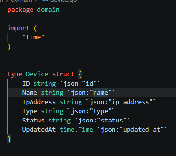
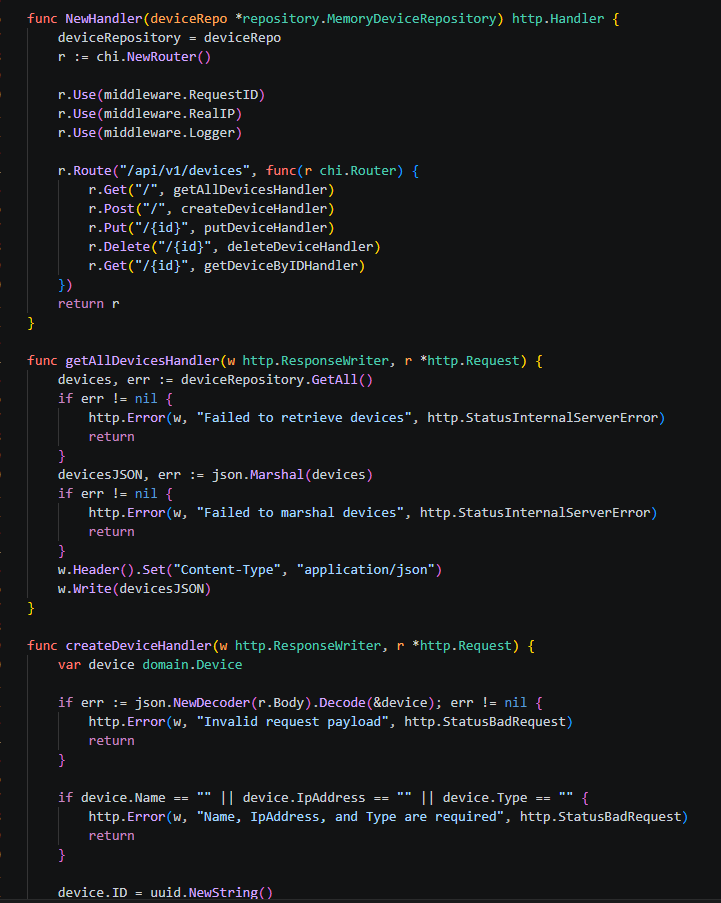
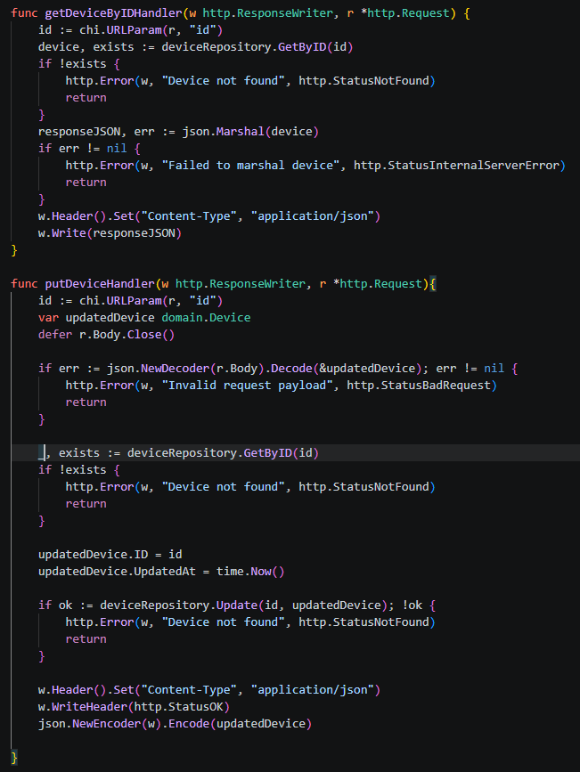
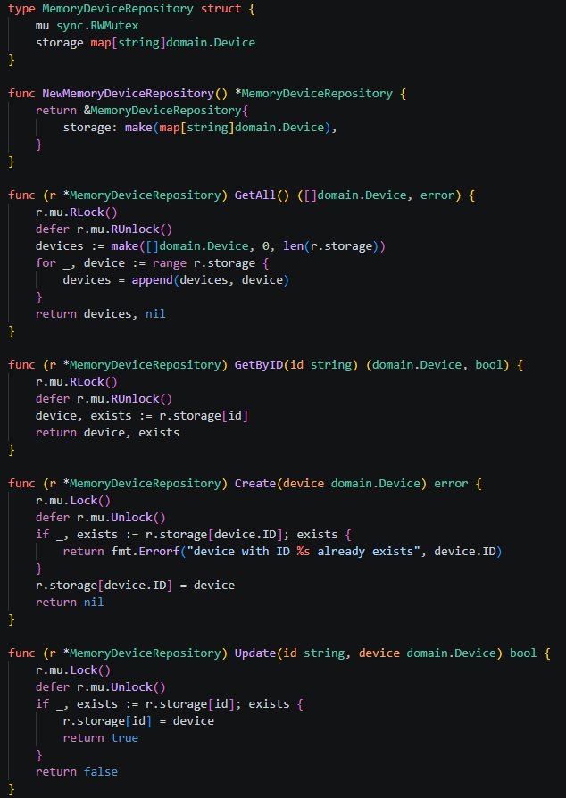
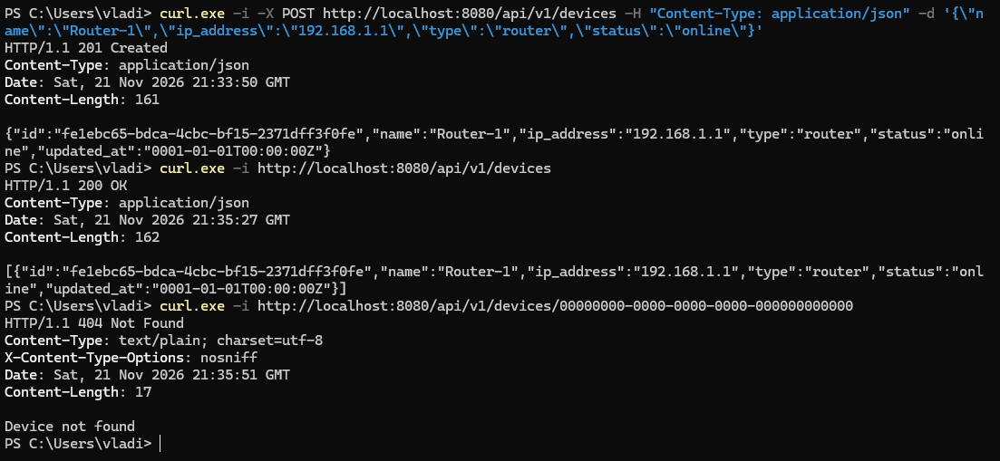
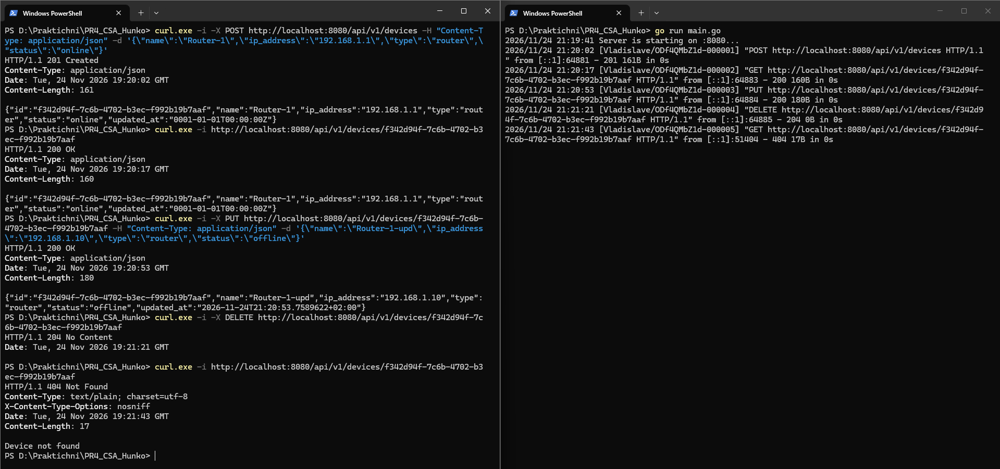

# Практична робота № 4. REST API реєстру пристроїв на маршрутизаторі Chi

**Тема:** Побудова REST API з використанням маршрутизатора Chi
**Проєкт:** `PR4_CSA_Hunko` — вебсервіс реєстру пристроїв (Device Registry API)

## Зміст

1. [Опис проєкту](#1-опис-проєкту)
2. [Структура проєкту](#2-структура-проєкту)
3. [Модель даних](#3-модель-даних)
4. [Ендпоінти API](#4-ендпоінти-api)
5. [Архітектура та ключові рішення](#5-архітектура-та-ключові-рішення)
6. [Інструкція запуску](#6-інструкція-запуску)
7. [Тестування через curl](#7-тестування-через-curlexe)
8. [Скриншоти роботи програми](#8-скриншоти-роботи-програми)
9. [Статус виконання рівнів](#9-статус-виконання-рівнів)
10. [Висновок](#10-висновок)

---

## 1. Опис проєкту

У диспетчерських центрах та промислових IoT-системах потрібен централізований облік вузлів мережі: датчиків температури, шлюзів, реле керування, серверів. Перед початком передачі телеметрії пристрій потрібно зареєструвати, перевірити його статус, за потреби змінити конфігурацію або вивести з експлуатації.

Проєкт — **вебсервіс реєстру пристроїв (Device Registry API)**, який:

- надає REST-інтерфейс для керування життєвим циклом пристрою (створення, читання, оновлення, видалення);
- зберігає дані в потокобезпечному in-memory сховищі на базі `map` та `sync.RWMutex`;
- маршрутизує запити через `go-chi/chi/v5` (суб-роутер `r.Route`, параметр шляху `chi.URLParam`);
- обробляє запити через конвеєр Middleware (`RequestID`, `RealIP`, `Logger`);
- повертає відповіді у форматі JSON зі стандартними кодами стану HTTP (200, 201, 204, 400, 404, 500).

**Мета роботи:** опанувати принципи проєктування REST API (семантика HTTP-методів, ідемпотентність, коди стану), роботу з маршрутизатором Chi, шарувату архітектуру (`domain` / `repository` / `handler`), потокобезпечне сховище та Middleware.

**Технології:** Go, [`go-chi/chi/v5`](https://github.com/go-chi/chi), [`google/uuid`](https://github.com/google/uuid), `net/http`, `encoding/json`, `sync`.

## 2. Структура проєкту

```
PR4_CSA_Hunko/
├── main.go                                     # точка входу, запуск HTTP-сервера на :8080
├── go.mod
├── go.sum
├── README.md                                   # цей звіт
├── docs/screenshots/                           # скриншоти для звіту
└── internal/
    ├── domain/
    │   └── device.go                           # модель Device
    ├── repository/
    │   └── memory_device_repository.go         # in-memory сховище (sync.RWMutex)
    └── handler/
        └── main_handler.go                     # маршрути Chi, Middleware, HTTP-обробники
```

## 3. Модель даних

Структура `Device` (`internal/domain/device.go`):

| Поле JSON    | Тип Go      | Опис                                           |
|--------------|-------------|------------------------------------------------|
| `id`         | `string`    | унікальний ідентифікатор (UUID, генерує сервер) |
| `name`       | `string`    | назва пристрою (**обов'язкове**)               |
| `ip_address` | `string`    | мережева IP-адреса (**обов'язкове**)           |
| `type`       | `string`    | тип вузла: `sensor`, `gateway`, `controller` … (**обов'язкове**) |
| `status`     | `string`    | поточний стан: `online`, `offline`             |
| `updated_at` | `time.Time` | мітка часу останньої модифікації (виставляється при PUT) |

## 4. Ендпоінти API

Базовий префікс: `/api/v1/devices`

| Метод    | Шлях                    | Опис                                   | Успіх          | Помилки                                   |
|----------|-------------------------|----------------------------------------|----------------|-------------------------------------------|
| `GET`    | `/api/v1/devices`       | список усіх пристроїв                  | `200 OK`       | `500`                                     |
| `POST`   | `/api/v1/devices`       | створення пристрою (ID генерується)    | `201 Created`  | `400` — невалідний JSON або немає `name` / `ip_address` / `type` |
| `GET`    | `/api/v1/devices/{id}`  | отримання пристрою за ID               | `200 OK`       | `404 Not Found`                           |
| `PUT`    | `/api/v1/devices/{id}`  | повна заміна даних, `updated_at = now` | `200 OK`       | `400`, `404 Not Found`                    |
| `DELETE` | `/api/v1/devices/{id}`  | видалення пристрою                     | `204 No Content` (без тіла) | `404 Not Found`             |

## 5. Архітектура та ключові рішення

**Шарувата архітектура**

- `domain` — лише модель даних, без залежностей від HTTP чи сховища.
- `repository` — шар збереження стану. Методи: `GetAll`, `GetByID`, `Create`, `Update`, `Delete`.
- `handler` — HTTP-обробники та налаштування роутера; працюють із репозиторієм і формують відповіді.

**Потокобезпека.** Кожен запит обробляється в окремій горутині, а паралельний доступ до звичайної `map` призводить до паніки `concurrent map read and map write`. Тому сховище захищене `sync.RWMutex`:

- читання (`GetAll`, `GetByID`) — `RLock()` / `RUnlock()`: кілька клієнтів читають одночасно;
- модифікація (`Create`, `Update`, `Delete`) — `Lock()` / `Unlock()`: ексклюзивний доступ.

**Middleware** (підключені в `NewHandler`):

- `middleware.RequestID` — унікальний ідентифікатор кожного запиту;
- `middleware.RealIP` — визначення реальної адреси клієнта;
- `middleware.Logger` — журнал запитів у консолі сервера: метод, шлях, віддалена адреса, код відповіді, розмір, тривалість.

**Маршрутизація.** Роутер `chi.NewRouter()`, група маршрутів через `r.Route("/api/v1/devices", ...)`, параметр шляху читається через `chi.URLParam(r, "id")`.

## 6. Інструкція запуску

### Вимоги

- Go SDK 1.22 або новіший (у `go.mod` вказано `go 1.27.2`);
- Git;
- термінал: PowerShell, cmd, bash або zsh;
- `curl.exe` (входить до складу Windows 10/11) для тестування.

### Кроки

```powershell
# 1. Клонувати репозиторій і перейти в каталог проєкту
git clone <URL-репозиторію>
cd PR4_CSA_Hunko

# 2. Завантажити залежності (chi, uuid)
go mod tidy

# 3. Запустити сервер
go run main.go
```

Після запуску в консолі з'явиться повідомлення:

```
Server is starting on :8080...
```

Сервер слухає порт **8080**. Зупинити його можна комбінацією `Ctrl+C`.

> Якщо проєкт створюється з нуля: `go mod init PR4_CSA_Hunko`, `go get github.com/go-chi/chi/v5`, `go get github.com/google/uuid`.

## 7. Тестування через curl.exe

Запити виконуються в **другому** вікні терміналу, поки сервер працює в першому. Приклади для **PowerShell** (замість `<ID>` підставити `id`, який повернув запит створення).

**Create**
```powershell
curl.exe -i -X POST http://localhost:8080/api/v1/devices -H "Content-Type: application/json" -d '{\"name\":\"Router-1\",\"ip_address\":\"192.168.1.1\",\"type\":\"router\",\"status\":\"online\"}'
```

**Read (список та один пристрій)**
```powershell
curl.exe -i http://localhost:8080/api/v1/devices
curl.exe -i http://localhost:8080/api/v1/devices/<ID>
```

**Update**
```powershell
curl.exe -i -X PUT http://localhost:8080/api/v1/devices/<ID> -H "Content-Type: application/json" -d '{\"name\":\"Router-1-upd\",\"ip_address\":\"192.168.1.10\",\"type\":\"router\",\"status\":\"offline\"}'
```

**Delete**
```powershell
curl.exe -i -X DELETE http://localhost:8080/api/v1/devices/<ID>
```

**Read після видалення — очікується 404**
```powershell
curl.exe -i http://localhost:8080/api/v1/devices/<ID>
```

**Неіснуючий ідентифікатор — очікується 404**
```powershell
curl.exe -i http://localhost:8080/api/v1/devices/00000000-0000-0000-0000-000000000000
```

## 8. Скриншоти роботи програми

### 8.1. Реалізація (код)

**Доменна модель `Device`** — поля з JSON-тегами: `id`, `name`, `ip_address`, `type`, `status`, `updated_at`.



**Роутер Chi, Middleware та обробники списку й створення.** Видно підключення `RequestID`, `RealIP`, `Logger`, групу маршрутів `/api/v1/devices` (GET, POST, PUT, DELETE) та валідацію обов'язкових полів у POST.



**Обробники `GET /{id}` та `PUT /{id}`** — витягування ID через `chi.URLParam`, відповіді `404 Not Found`, оновлення `updated_at`.



**Потокобезпечний репозиторій** — `sync.RWMutex`, `RLock` для читання, `Lock` для запису.



### 8.2. Рівень 1 — створення, список, неіснуючий ID

`POST` повертає `201 Created` із згенерованим UUID, `GET /api/v1/devices` повертає `200 OK` зі списком, а запит із неіснуючим ID — `404 Not Found` і текст `Device not found`.



### 8.3. Рівень 2 — повний життєвий цикл ресурсу

Зліва — запити `curl.exe` у послідовності **Create → Read → Update → Delete → Read**, справа — консоль сервера з журналом `middleware.Logger`.



Підсумок за кодами стану:

| Крок       | Запит                 | Код відповіді         |
|------------|-----------------------|-----------------------|
| Create     | `POST /devices`       | `201 Created`         |
| Read       | `GET /devices/{id}`   | `200 OK`              |
| Update     | `PUT /devices/{id}`   | `200 OK` (`updated_at` оновлено) |
| Delete     | `DELETE /devices/{id}`| `204 No Content`      |
| Read       | `GET /devices/{id}`   | `404 Not Found`       |

Помилок виконання немає: сервер відповідає на кожен запит, після `DELETE` залишається працездатним, а журнал показує усі п'ять запитів із кодами `201, 200, 200, 204, 404`.

## 9. Статус виконання рівнів

| Рівень | Зміст | Статус |
|--------|-------|--------|
| **1. Базовий** | структура `domain` / `repository` / `handler`, модель `Device`, in-memory репозиторій з `RWMutex`, `GET` список, `POST`, `GET /{id}`, тестування curl | ✅ виконано |
| **2. Ключовий** | `PUT` та `DELETE`, методи `Update` / `Delete` у репозиторії, Middleware логування (`RequestID`, `RealIP`, `Logger`), повний цикл Create → Read → Update → Delete → Read | ✅ виконано |
| **3. Просунутий** | фільтрація `?status=` / `?type=`, єдиний JSON-формат помилок (`error`, `message`, `status`, `timestamp`), Panic Recovery та CORS Middleware | ⬜ не реалізовано |

## 10. Висновок

У ході практичної роботи розроблено REST API реєстру пристроїв на маршрутизаторі `go-chi/chi/v5` із шаруватою архітектурою (`domain`, `repository`, `handler`). Реалізовано повний CRUD для ресурсу `Device`: створення, отримання списку й окремого пристрою, оновлення та видалення. Дані зберігаються в потокобезпечному in-memory сховищі на `sync.RWMutex`, запити проходять через Middleware `RequestID`, `RealIP` і `Logger`, а відповіді повертаються у форматі JSON зі стандартними кодами стану (`200`, `201`, `204`, `400`, `404`).

Працездатність підтверджена тестуванням через `curl.exe`: повний життєвий цикл Create → Read → Update → Delete → Read завершується очікуваним `404 Not Found` після видалення. Виконано вимоги рівнів 1 і 2. Рівень 3 (фільтрація, єдиний формат помилок, Panic Recovery, CORS) залишається напрямом подальшого розвитку проєкту.
